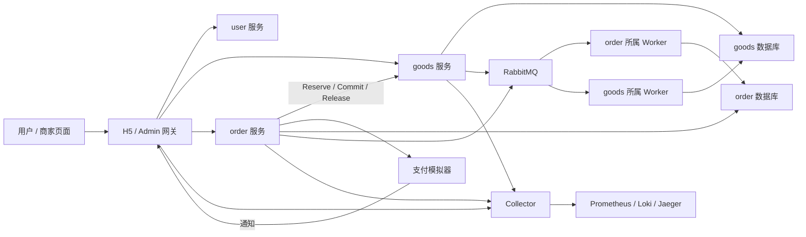
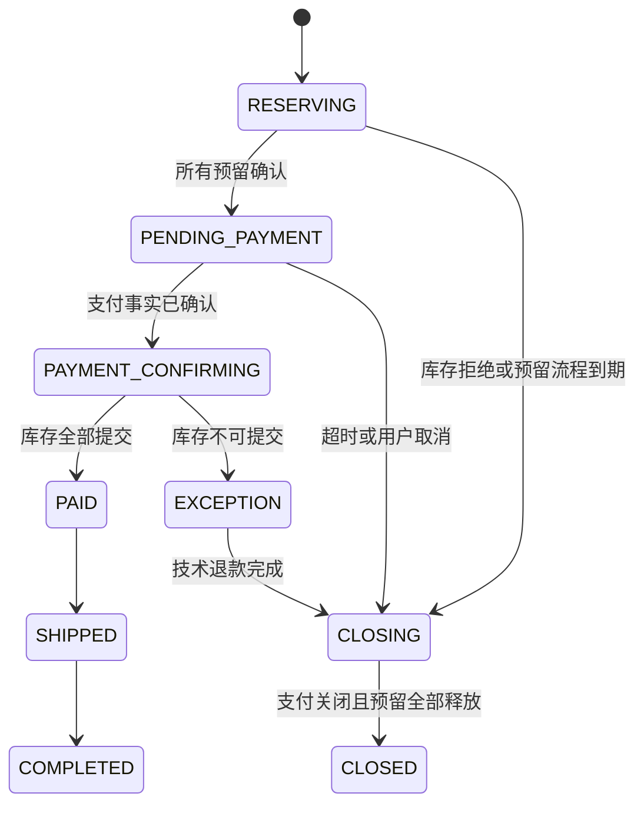

# GoFrame 微服务商城：交易可靠性与故障实验设计

> 日期：2026-09-07；状态：基于教程演示源码的目标设计，待用户审阅。  
> 方法：Superpowers brainstorming（上下文、方案比较、边界、成文、自检）。  
> 配套文档《求职定位与简历面试导航》《日志诊断 Agent 详细设计》不在本仓库中。
>
> **阅读须知**：本文分析的是原课程演示源码（`shop-goframe-micro-service-refacotor-master-…`），该源码**不在本仓库**。下文的源码路径、B1–B7 问题和 goods/order/RabbitMQ 等组件都属于那份源码；本仓库是按 [`architecture/overview.md`](architecture/overview.md) 从零重建的，目前只有 `user` 与 `gateway-h5`。版本基线也以本仓库为准（GoFrame v2.10.2、MySQL 8.4.11），不以第 2.1 节为准。

<a id="scope"></a>
## 1. 目标、范围与验收边界

复用 GoFrame 商城核心代码，围绕“下单—库存预留—模拟支付—关单/履约”补全持久化状态与恢复协议。先验证现有实现，再完成两至三个有证据的独立改进；同时向诊断 Agent 提供遥测。

第一版覆盖普通购买、多商品订单、库存预留、模拟支付、取消/超时关单、技术补偿退款、简化发货收货。优惠券、秒杀、评论、搜索和资源网关保持现有模块但不纳入新交易协议首批验收；新接口暂不接受优惠券，避免无意承诺兼容旧优惠券流程。

不做真实资金上线、独立支付微服务迁移、竞拍、多地域、服务网格、自研共识或存储。支付先作为订单服务内部模块，模拟器单独进程；后续独立拆分需新增 ADR。

**完成定义：**正常流程可运行；重试、乱序、响应丢失与进程重启实验下不变量成立；故障证据可查询；性能报告口径明确。单机 Compose 不代表节点级高可用，本轮仅静态阅读与设计，没有执行项目测试。

<a id="baseline"></a>
## 2. 演示源码基线与改造依据

源码目录：`shop-goframe-micro-service-refacotor-master-1fc3b07da73f87be5bf83f0eab933124113a5eab/`。下文源码相对路径均基于该目录，新增路径明确标注“拟新增”。本次未修改业务源码。

### 2.1 已核对事实

- 根 `go.mod`：Go 1.23.10，GoFrame 主模块 2.9.4，部分驱动 2.9.0，gRPC 1.74.2，amqp091-go 1.10.0。先沿用锁定版本，不附带升级全项目。
- `docker-compose.yml`：MySQL 8.0、Redis 7、etcd、RabbitMQ 4.1.0，包含 goods、order、user 等服务以及 H5/Admin/Resource 网关。
- `app/order/internal/logic/order_info/order_info.go`：创建订单事务提交后，异步发送创建、优惠券确认和超时事件。
- `app/goods/utility/consumer/order_created_consumer.go`：订单创建消息触发购物车删除和库存扣减。
- 库存位于 goods 服务；支付和退款相关代码位于 order 与 gateway-h5，不存在本设计假定的独立 payment 服务。
- 有 Prometheus 工具包与部分测试。所检查 Compose 未包含 Jaeger/Nacos；在 `app`、`utility` 的相关 Go 源码关键词检索未定位到显式接入。不能把课程标题当作端到端追踪已经可用。
- `app/flash-sale` 存在独立 go.mod，根模块测试不代表该模块也被覆盖。


源码导航：订单创建与状态更新（`order_info.go`） · 消费者幂等与重试（`consumer_manager.go`） · 超时消费者（`order_timeout_consumer.go`） · 库存扣减与返还（`goods_info.go`） · 发布封装（`rabbitmq.go`） · 锁定依赖（`go.mod`）（以上文件位于原课程源码，不在本仓库）

### 2.2 可复现问题候选

下表是静态控制流发现，不是运行复现报告；实施前用测试确认真实行为。

| 编号 | 源码位置 | 观察与风险 | 首个实验 |
|---|---|---|---|
| B1 | `app/order/internal/logic/order_info/order_info.go` 的 Create，事务提交及后续事件发布 | DB 提交与 goroutine 发消息之间无同事务投递记录；中断可能留下缺少后续处理的订单 | 提交后、发布前暂停并终止进程 |
| B2 | `utility/rabbitmq/consumer_manager.go` 的 handleMessage/checkIdempotency | 处理前设置锁，重复锁被当已完成并 ACK；处理失败未见释放或完成态区分 | 首次业务失败后重投同消息 |
| B3 | 同文件重试路径 | 修改本地 Delivery.Headers 后仅 Nack requeue，不会把修改后的头写回 Broker | 连续失败观察实际重投计数 |
| B4 | `app/order/utility/consumer/order_timeout_consumer.go` 与 HandleOrderTimeoutResult | 条件更新 0 行返回 nil，调用方随后仍发返库存事件；可能对已支付订单发出释放请求 | 已支付订单收到超时事件 |
| B5 | UpdateOrderStatusByNumber | 先检查是否已支付，再按订单号无前态条件更新，无法单靠该逻辑阻止并发关单覆盖 | 用屏障同时执行回调和关单 |
| B6 | `app/goods/internal/logic/goods_info/goods_info.go` | 扣减与返还读取 stock 后写计算值，未见操作级持久幂等记录；存在重复处理及并发覆盖风险 | 同库存行并发消费、重复返还 |
| B7 | `utility/rabbitmq/rabbitmq.go` | 普通 Publish 未设 persistent，所读封装未启用 publisher confirms；连接 URL 被日志输出 | 隔离 Broker 故障并检查脱敏日志 |

此外，checkIdempotency 对缺少 MessageId 的消息使用 `msg.Body[:32]`，短消息存在切片越界路径。新消息协议必须使用稳定 event_id，非法消息直接归档，不依赖消息前缀识别业务操作。

本设计优先解决 B1/B2/B4/B5，并将 B6 对应库存协议作为交易闭环基础。B7 的日志脱敏在接入 Agent 前完成，避免把凭证送入模型。

<a id="decisions"></a>
## 3. 方案比较与默认选型

### 3.1 交易方案

| 方案 | 收益 | 代价 | 决定 |
|---|---|---|---|
| A：保留“先订单、后消息扣库存”，增加持久状态与补偿 | 改动较少 | 必须把返回语义改为处理中，处理已付款但库存失败等分支 | 可作为旧链路回归对照 |
| B：持久订单流程＋同步库存预留＋后台恢复 | 待支付明确意味着库存已预留，故障步骤容易观察 | 新增预留模型和流程恢复 | **默认目标** |
| C：完整 TCC 框架或 Redis 预扣主导 | 可扩展更多参与方/热路径优化 | 协调器、悬挂、持久化与双存储恢复范围更大 | 首版不采用 |

B 使用订单服务持久化编排，本地事务只管本服务，跨服务失败通过恢复与补偿处理，可视为有明确编排者的 Saga。库存 Reserve/Commit/Release 接口有预留语义，但不宣称已经实现完整通用 TCC 框架。

### 3.2 架构决定

| 决定 | 默认方案 | 理由与局限 |
|---|---|---|
| 框架 | 保留 GoFrame、gRPC 和现有网关 | 避免重写基础，新增契约使用 v2 |
| 库存权威 | goods 的 MySQL 预留与库存账本 | 易与幂等结果同事务；吞吐需测量，Redis 不裁定新链路库存 |
| 消息 | RabbitMQ＋每服务本地 Outbox/Inbox | 解决已观察到的 DB/发布与重复消费窗口 |
| 支付 | order 内支付模块＋独立模拟器 | 保留代码边界，先做可靠性，不新增不必要微服务 |
| 服务发现 | 沿用 etcd | 配置先用版本化文件/环境变量，Nacos 非首版依赖 |
| 遥测 | OTel Collector＋Prometheus＋Loki＋Jaeger | 统一收集，Jaeger 作为唯一 Trace 后端；不另上 Tempo |
| 前端 | React＋TypeScript，若已有可用前端则保留 | 新增页面以订单状态和异常记录为主 |
| 部署 | 新增隔离 Compose 配置 | 首版进程故障实验，集群高可用后续单独设计 |

上述是目标选择。旧 Lua 秒杀方案只作隔离实验，不允许同一库存同时被旧链路与新链路裁定。

<a id="architecture"></a>
## 4. 组件与部署边界



Worker 是所属服务内部逻辑的独立运行模式，不通过 Go internal 跨边界导入其他服务。复用 `app/order`、`app/goods` 结构，公共 `utility/rabbitmq` 只提供传输与确认，不决定所有业务的幂等结果。

最小环境启动 MySQL、Redis、RabbitMQ、etcd、user、goods、order、H5 网关、模拟器及遥测；商家演示再启动 Admin。搜索、Banner、交互和秒杀不属于核心依赖。

数据库可共用一台 MySQL 实例但使用独立 schema/账号。允许测试进程读取多个 schema 验证不变量，业务服务不能跨库改数据。模拟器以自己的数据库保存支付事实，不能直接更新 order 数据库。

退出流程：停止接收新请求/新任务，取消未开始工作，等待有限时间，未完成持久任务留给下一进程；禁止用请求结束后的裸 goroutine 承担唯一可靠投递职责。

<a id="data"></a>
## 5. 数据模型与唯一约束

金额统一为 int64 最小货币单位，币种首版 CNY；数量为正整数。服务器读取商品价格并保存快照，不信任客户端总价。时间以 UTC 持久化，超时判断使用数据库时间；operation_id 在重试时保持不变。

### 5.1 order schema（目标增量）

| 表 | 核心字段 | 约束与索引 |
|---|---|---|
| `trade_orders` | id、user_id、request_id、request_hash、state、version、amount_minor、currency、expires_at、created_at | UNIQUE(user_id, request_id)，INDEX(state, expires_at) |
| `trade_order_items` | order_id、sku_id、qty、unit_price_minor、reservation_id | UNIQUE(order_id, sku_id)，UNIQUE(reservation_id) |
| `trade_workflows` | order_id、step、status、attempts、next_attempt_at、owner、lease_until、last_error | UNIQUE(order_id)，INDEX(status, next_attempt_at) |
| `payment_attempts` | payment_id、order_id、provider_tx_id、state、amount_minor、currency、provider_version | UNIQUE(order_id)，UNIQUE(provider_tx_id)，首版每订单一个支付单 |
| `refund_attempts` | refund_id、payment_id、reason、state、attempts、next_attempt_at | UNIQUE(payment_id, reason)，技术退款固定 reason=LATE_PAYMENT |
| `outbox_events` | event_id、aggregate_id、aggregate_version、type、payload、state、attempts、next_attempt_at、owner、lease_until | PK(event_id)，INDEX(state, next_attempt_at) |
| `inbox_events` | consumer、event_id、payload_hash、completed_at | PK(consumer, event_id) |
| `trade_transitions` | transition_id、order_id、from_state、to_state、version、cause_id、at | UNIQUE(order_id, version) |

为避免直接改变旧数字状态含义，目标使用新表/新 v2 接口，演示环境先仅导入商品与用户种子，不迁移活跃订单。旧订单查询仍用旧逻辑；新链路关闭旧库存事件订阅，避免双扣。迁移是实验范围内的明确切换，不做线上双写。

### 5.2 goods schema

| 表 | 核心字段 | 约束 |
|---|---|---|
| `inventory` | sku_id、available、reserved、sold、version | PK(sku_id)，三数量均非负 |
| `reservations` | reservation_id、order_id、sku_id、qty、request_hash、state、created_at、updated_at | PK(reservation_id)，UNIQUE(order_id, sku_id) |
| `inventory_operations` | operation_id、request_hash、outcome、response_json | PK(operation_id)，与库存事务同提交 |
| `inbox_events` / `outbox_events` | 同上 | 各属于 goods 本地事务 |

无补货/售后退货实验期间：初始总量 = available + reserved + sold。Reserve：available 减、reserved 加；Commit：reserved 减、sold 加；Release：reserved 减、available 加。已售库存不通过 Release 返还；首版退款处理在未完成履约的技术补偿范围内。

### 5.3 幂等与保留期

- 下单 request_hash 包含排序并合并后的商品数量、地址快照标识、币种；同 ID 不同请求返回冲突。
- Reserve 操作 ID 从 order_id 派生，不使用每次 RPC 新生成的 Trace ID。
- 幂等结果与业务更新同事务提交；失败前的暂时错误不存成完成。
- 演示环境保留业务操作与终态墓碑 30 天，最长自动重试窗口 24 小时；超窗事件归档人工核验，不自动重放旧命令。订单仍保留唯一业务标识，不在活跃流程中清理。

<a id="flows"></a>
## 6. 状态机与关键时序

### 6.1 订单状态



支付状态：CREATED → SUCCEEDED 或 CLOSED；SUCCEEDED → REFUNDING → REFUNDED。UNKNOWN 是本地查询/请求结果未知标记，不能覆盖已确认的 SUCCEEDED。模拟器 Close 与 Pay 在自己的事务中竞争，返回已成功时不会被强制改为关闭。

模拟器契约：payment_id 由 order_id 稳定派生；Create、Pay、Close、Query、Refund 都支持稳定请求 ID。Close 可在支付单未创建时写 CLOSED 墓碑，后续迟到 Create/Pay 不得重新打开；因此订单关闭与支付创建竞争不会留下新的可支付单。Pay 与 Close 在模拟器同一支付行事务裁定，回调只是通知，Query 返回其持久事实。退款以固定 refund_id 幂等，查询可区分未受理、处理中、成功和失败。

CLOSING/CLOSED 收到支付成功：保存真实支付结果并安排退款，不重开订单、不进入发货。CLOSED 表示订单结束；退款单可以继续 REFUNDING，页面分别展示订单与退款状态，避免混淆。关闭前对未知支付保持 CLOSING；晚到或异常外部事实仍可触发技术退款。

### 6.2 下单与库存预留

1. 网关认证用户、校验参数、合并重复 sku；价格由 goods 查询得到并保存快照。
2. order 本地事务创建 RESERVING 订单、明细和 RESERVE 工作流；重复 request_id 返回同订单，参数不一致为 409。
3. 事务外调用 goods.Reserve，以稳定 operation_id 提交整单商品列表。
4. goods 事务插入/锁定操作记录，按 sku_id 排序锁定全部库存与预留记录，先检查全部商品再更新。任一商品不足则仅提交操作的业务拒绝结果，不产生任何库存修改；暂时数据库故障整体回滚。唯一键冲突后读取已提交结果，不用新的操作 ID 绕过冲突。
5. 成功事务写所有 reservations 与幂等结果。重复调用和 QueryOperation 返回不可变 original_outcome 以及事务一致读取的 current_reservation_states；历史 SUCCESS 不等于当前仍持有预留。响应丢失后可查询或同 ID 重试。
6. order 仅在返回的所有预留状态为 RESERVED，且自身 state=RESERVING 时条件迁移至 PENDING_PAYMENT；其他终态进入对应关闭/冲突处理。迁移时同时设置不可变 expires_at=本次数据库时间+15分钟，并写到期任务与 Outbox；RESERVING 期间 expires_at 为空，使用 created_at+60秒的预留流程截止时间。只有此时 UI 显示可支付。
7. 前台请求预算到期返回 202 与 order_id，后台继续查询恢复；不把超时直接当成“下单失败”。

预留流程默认总时限 60 秒，限时后转 CLOSING 并发送整单 Release。Release 必须为尚未到达的 reservation_id 写 RELEASED 墓碑，迟到的 Reserve 看到墓碑后拒绝，不能在订单关闭后新建悬空预留。

Reserve 与 Release 都按相同 sku 顺序操作，先锁/插入 reservation 主键并处理唯一冲突，再改变库存；多商品事务遵循固定顺序，死锁时在限定预算内重试整个事务。

### 6.3 库存接口状态规则

| 当前预留状态 | Reserve 同参数 | Commit | Release |
|---|---|---|---|
| 不存在 | 按库存创建 RESERVED | NOT_READY，可稍后重试 | 写 RELEASED 墓碑，不加库存 |
| RESERVED | 返回原结果 | 转 COMMITTED，移入 sold | 转 RELEASED，归还一次 |
| COMMITTED | 返回已提交结果 | 幂等成功 | CONFLICT，不返还已售库存 |
| RELEASED | 明确已撤销，不重新预留 | CONFLICT | 幂等成功 |

对 RELEASED 墓碑，保存 order_id/sku/qty/hash，拒绝同 ID 不同参数。库存没有独立本地 TTL 自动释放；由持久订单流程发起 Release，避免各服务时钟独立裁定。

### 6.4 支付确认与关单竞争

回调先验证签名/金额/币种/订单归属，再以 provider_tx_id 和事件 ID 去重。支付事实与订单迁移在 order 本地事务中记录，不能先 Exists 再无条件更新。

- 如果订单是 PENDING_PAYMENT，成功回调原子迁移至 PAYMENT_CONFIRMING，并写 COMMIT_INVENTORY 工作流。
- 如果关单先把订单改为 CLOSING，回调记录 SUCCEEDED 后创建技术退款任务，订单保持关闭路径。
- 如果回调先赢，关单条件更新 0 行，返回 `changed=false`，不得创建释放任务。
- PAYMENT_CONFIRMING 重试 Commit，全部成功才到 PAID；部分结果未知先查询，不发货。不可恢复的库存冲突到 EXCEPTION 并退款，人工入口保留审计。

到期 Worker 读取订单 persisted expires_at，不用“事件时间＋当前配置值”重算截止时间。先争取 PENDING_PAYMENT → CLOSING，再调用支付 Close/Query：未支付且关闭成功则释放；已支付则退款后释放；未知则继续核验。订单本地事务中不持有跨网络调用的锁。

### 6.5 请求示例

```json
{
  "request_id": "checkout-demo-001",
  "items": [{"sku_id": 101, "quantity": 2}],
  "address_id": 8
}
```

首次创建的 201 表示已到 PENDING_PAYMENT，202 表示已持久接受、仍在 RESERVING；重复请求返回 200 与当前真实状态，不强行返回“可支付”。响应均包含 order_id、state、version。技术错误但结果未知时客户端沿用 request_id 查询，不另建订单。

<a id="contracts"></a>
## 7. API 与事件契约

### 7.1 外部 HTTP（新 v2，不覆盖旧接口）

| 接口 | 权限 | 结果 |
|---|---|---|
| POST /v2/orders | 登录用户 | 创建/返回相同请求订单，201/202/409 |
| GET /v2/orders/{id} | 订单所属用户或有审计权限商家 | 订单、库存准备状态、支付/退款摘要 |
| POST /v2/orders/{id}/payment | 订单所属用户 | 创建/返回稳定 payment_id，非待支付拒绝 |
| POST /v2/orders/{id}/cancel | 订单所属用户 | 幂等进入关闭流程，返回实际状态 |
| POST /v2/payments/notify | 支付模拟器签名 | 仅持久接收成功返回 2xx |
| POST /v2/admin/orders/{id}/ship | 商家角色、仅所属商品订单 | 仅 PAID 可迁移，重复 operation_id 幂等 |
| POST /v2/orders/{id}/receive | 订单所属用户 | 仅 SHIPPED 可完成 |
| GET /v2/admin/trade-exceptions | 授权商家/运营 | 列表、原因、下一次重试与处理历史 |

### 7.2 goods RPC（目标语义）

- ReserveInventory(operation_id, order_id, items, request_hash) → original_outcome、reservation_ids、current_reservation_states；同 ID 重试返回历史执行结果及当前资源状态。
- QueryInventoryOperation(operation_id) → FOUND/NOT_FOUND、不可变 original_outcome 及当前 reservation 状态。NOT_FOUND 不证明先前请求不会迟到。
- CommitInventory(operation_id, reservation_ids) → 每项状态；整单同事务提交。
- ReleaseInventory(operation_id, order_id, items) → 每项状态；不存在时写墓碑。

错误类别：INVALID_ARGUMENT、IDEMPOTENCY_CONFLICT、INSUFFICIENT_STOCK、STATE_CONFLICT、UNAVAILABLE、DEADLINE_EXCEEDED。后两者允许在预算内重试；状态冲突进入业务分支，不能当网络错误无限重试。

RPC 默认单次 800ms，整次前台下单预算 3s、最多一次同步重试；后台首次 1s、之后指数退避上限 30s并加抖动。值是实验初值，配置版本与实际测量一起记录。

### 7.3 事件信封

```json
{
  "schema_version": 1,
  "event_id": "evt-demo-001",
  "type": "order.closed",
  "aggregate_id": "order-demo-001",
  "aggregate_version": 4,
  "occurred_at": "2026-09-07T10:00:00Z",
  "environment": "experiment",
  "traceparent": "W3C trace context value",
  "payload": {"order_id": "order-demo-001", "reason": "payment_expired"}
}
```

事件 ID 在首次事务生成，重发不改变。事件携带事实，不授权任意库存变更；消费方按资源当前状态核验。相同 event_id 不同 payload_hash 归档告警。乱序事件不能通过版本比较简单丢弃所有旧事件；库存动作以 reservation 状态机裁定，普通展示投影才可忽略更旧版本。

<a id="recovery"></a>
## 8. 消息、任务与恢复协议

### 8.1 Outbox

业务事实与 Outbox 同本地事务提交。Relay 通过 MySQL 短事务领取到期记录，带 owner/lease_until，事务外发布；使用 durable 队列、persistent 消息、mandatory 路由及 publisher confirms。只有收到 confirm 且未被退回时标记 SENT；超时或断连按未知处理，用原 event_id 重发。

Broker confirm 与消费者 ACK 覆盖不同阶段，前者不表示业务消费已完成；重复投递是必须处理的正常情况。[RabbitMQ 官方说明](https://www.rabbitmq.com/docs/confirms)

Relay 租约初值 15s，发布超时 5s；更新任务结果时检查 owner 和租约。发布后更新 SENT 前崩溃会重复发送，由 Inbox 抵消业务重复。

### 8.2 Inbox 与重试

消费事务：插入 `(consumer,event_id,payload_hash)` → 执行业务条件迁移 → 产生必要 Outbox → 提交 → ACK。重复已完成记录返回成功；事务未完成崩溃则记录一同回滚。

需要外部 RPC 的消费只在本地事务写持久工作流后 ACK；不能在一个 MySQL 事务里“保护”远程结果。任务再以稳定 operation_id 调用远端。

业务暂时失败时，在同库创建 retry_task，唯一 `(consumer,event_id)`、保存 payload 与 next_attempt_at，成功落库后 ACK 原消息；数据库不可用时保留未确认/关闭 channel 后退避重连，不把存储失败当作已完成。重试由任务表 attempts 持久计数，不修改 Delivery 内存 Header 期待 Broker 记住。

任务到达 24 小时重试窗口后进入 NEEDS_REVIEW，保留事件与错误，不静默丢弃。支付结果仍未知的关闭任务保持 CLOSING、保留库存并告警，不能为满足恢复时限强行释放；实验验收需单独统计这种未收敛状态。非法 schema、参数冲突写隔离记录后 ACK；隔离记录也失败则不 ACK。

### 8.3 到期与补偿任务

RabbitMQ 延迟通知作为唤醒优化，数据库 `expires_at` 扫描作为正确性兜底。每秒扫描一批 100 条到期订单，按固定状态条件迁移；提前通知不丢弃唯一机会，仍有到期扫描。

MySQL 任务领取使用短事务锁与租约，状态更新核验 owner。重试次数用于告警与退避，不能决定远程副作用是否曾成功。进程重启重领任务，先查询已知操作结果，再继续下一步。

### 8.4 故障窗口清单

| 中断位置 | 持久事实 | 恢复方式 |
|---|---|---|
| 下单持久后 Reserve 前 | RESERVING＋workflow | 重领，调用稳定 Reserve ID |
| Reserve 成功响应丢失 | goods 的 operation/result | 查询或同 ID 重试 |
| 支付成功回调未到 | 模拟器支付事实 | 到期 Close/Query 收敛 |
| 业务提交后消息发布前 | Outbox PENDING | Relay 重试 |
| 发布成功但 SENT 未更新 | Broker 消息＋PENDING | 重发同 event_id，Inbox 去重 |
| 消费提交后 ACK 前 | Inbox＋业务事实 | 重投只 ACK，不重复变更 |
| 关闭状态更新 0 行 | 实际订单状态 | 返回 changed=false，不释放库存 |
| Release 先于 Reserve 到达 | RELEASED 墓碑 | 迟到 Reserve 拒绝 |

<a id="telemetry"></a>
## 9. 共享遥测契约 v1

此节是两个项目的共同契约来源。服务名使用现有部署名：gateway-h5、order-service、goods-service、user-service；目标新增 payment-simulator。环境固定 experiment，版本由构建注入。

### 9.1 日志与 Trace

JSON 日志字段：timestamp、severity、service.name、service.version、deployment.environment.name、event.name、trace_id、span_id、operation_id、order_id、error.type、message。缺失关联字段必须显式为空，不伪造 Trace。

业务事件：order.transition、inventory.reserved、inventory.released、payment.observed、payment.refund.requested、message.redelivered、workflow.retry。记录脱敏 ID、前后状态和错误码，不能记录 DSN、完整连接 URL、支付凭证、JWT、手机号或地址。

HTTP/gRPC 注入提取 W3C Trace Context；RabbitMQ 信封传播上下文，长时任务新建 Trace 并使用 Span Link 关联原请求。Span Link 可以关联不同 Trace 的异步工作。[OpenTelemetry Traces](https://opentelemetry.io/docs/concepts/signals/traces/)

### 9.2 指标与查询模板

| 指标 | 类型与单位 | 允许标签 |
|---|---|---|
| trade_order_create_total | counter | service、environment、outcome |
| trade_order_pending_payment | gauge | service、environment |
| trade_workflow_backlog | gauge | service、environment、step |
| trade_workflow_oldest_age_seconds | gauge 秒 | service、environment、step |
| trade_rpc_duration_seconds | histogram 秒 | service、environment、peer、method、outcome |
| trade_payment_callback_delay_seconds | histogram 秒 | service、environment |
| trade_db_pool_in_use / trade_db_pool_limit | gauge 连接数 | service、environment、pool |
| trade_db_acquire_timeout_total | counter | service、environment、pool |

outcome 和 step 为有限枚举；order_id、user_id、trace_id、sku_id 不作为通用指标标签。库存数量需要逐商品分析时查询授权测试接口或日志，避免无限标签集合。

Agent metric_key=rpc_latency_p95 对应服务端 PromQL 模板：

```promql
histogram_quantile(0.95,
  sum by (le) (rate(trade_rpc_duration_seconds_bucket{
    service="order-service",environment="experiment",peer="goods-service"
  }[2m]))
```

实际过滤值来自白名单，不由模型拼接查询。记录 scrape interval=5s、实验 Trace 采样=100%、采集时间与事件时间的差异；等待遥测可查询后再评分，不能因尚未采集就判 Agent 错误。

### 9.3 告警与变更

初值：一分钟技术错误率超过 5%且有至少 20 次请求；或待处理最老任务超过 30s。演示时使用背景流量制造可重复信号，阈值不是生产 SLO。

告警包含 alert_id、服务、环境、开始时间、指标摘要；不包含注入故障名称。变更记录包含 service、version/config_revision、effective_at、描述，不把故障真值写入 Agent 可读备注。

<a id="validation"></a>
## 10. 验证与实验矩阵

| ID | 注入与操作 | 判定式/结果 |
|---|---|---|
| T1 | 初始库存 10，100 个不同请求同时购买 1 | 成功有效分配≤10；available/reserved/sold 非负且总量守恒 |
| T2 | 同 request_id 并发 20 次 | 只有一个 order_id；不同参数返回冲突 |
| T3 | Reserve 提交后丢弃响应 | 重试只一份预留，恢复到待支付或关闭 |
| T4 | Release 先到、Reserve 后到 | 不增加库存，不创建迟到预留 |
| T5 | 用屏障竞争支付回调与关单 | 最终可履约或退款关闭，不同时释放已提交库存 |
| T6 | 已支付订单重放 timeout | changed=false，不生成新的库存释放 |
| T7 | 消费失败后重投、提交后 ACK 前 Kill | 失败可重试，已提交业务效果仅一次 |
| T8 | Relay 发布成功后 Kill | 重发 event_id 相同，消费端状态不重复 |
| T9 | 关闭通知缺失或提前到达 | 数据库扫描到期后完成核验，不永远待支付 |
| T10 | 新旧 Protobuf 客户端交叉运行 | 原字段仍可解码，新字段缺省有明确含义 |

固定输入、随机种子与屏障控制关键窗口；不得只依靠 sleep。记录失败、恢复后状态及未恢复数量。首次执行先针对旧链路复现 B1—B7，不要求把目标 T1—T10 都套到旧协议。

压测先预热 30s、稳态 5min，分别测普通多商品与单热点负载；值是初始测试方法。报告 CPU/内存、实例数、请求到达率、成功/业务拒绝/技术错误、接收吞吐与最终待支付吞吐、P50/P95/P99、积压和恢复耗时。测试结束等待在途请求收敛再验库存。

<a id="delivery"></a>
## 11. 分阶段交付与源码落点

这里只定义可独立验收的设计切片。审阅规格后，再按切片生成 Superpowers writing-plans 文件级 TDD 步骤；不把下面的拟新增命令当成已经存在。

| 切片 | 复用/修改位置 | 拟新增位置 | 完成标准 |
|---|---|---|---|
| S0 基线实验 | 已有 OrderInfo 与 ConsumerManager | `tests/fault/baseline_test.go`、`deploy/experiment/compose.yml` | B1/B2/B4 的可控复现或有证据排除 |
| S1 库存预留 | goods DAO/启动入口 | `app/goods/internal/logic/reservation/`、`manifest/protobuf/inventory/v2/`、`migrations/` | T1/T3/T4，原子结果与墓碑 |
| S2 新订单链路 | gateway-h5、order 服务注册 | `app/order/internal/logic/trade/`、`manifest/protobuf/trade/v2/` | T2、202 查询恢复、只预留后可支付 |
| S3 支付与关闭 | order 的支付适配边界 | `app/order/internal/logic/paymentflow/`、`cmd/payment-simulator/` | T5/T6/T9，状态与技术退款 |
| S4 可靠任务与消息 | utility/rabbitmq、服务消费者启动 | 各服务 `internal/logic/outbox/`、`internal/logic/inbox/` | T7/T8，持久重试、确认与隔离 |
| S5 遥测与前端 | utility/metrics、网关 | `web/trade/`、`deploy/experiment/otel/` | 真实信号可回查，页面展示中间态 |
| S6 集成与证据 | 两项目接口 | `tests/fault/`、`benchmarks/`、`reports/` | 完整交易演示和 Agent 使用场景 |

路径均相对源码根目录；位于 app/goods 的 migrations 路径也应归该服务，不由全局工具跨库写业务。每个切片保留独立启动和回归能力；S1—S4 完成前旧 v1 与新 v2 用隔离商品数据。

目标 Makefile 契约：`make test-trade`（纯业务单测）、`make test-trade-integration`（隔离 MySQL/RabbitMQ）、`make fault-trade`（上述故障矩阵）、`make bench-trade`（报告）、`make demo-trade`（启动）。实现时明确其脚本与退出码；本次没有新增这些目标或运行它们。

## 12. 风险、决定记录与审阅清单

- 新 v2 是实质性增量，需要分阶段交付；不能边共享库存边运行旧异步扣减链路。
- MySQL 为正确性权威会引入热点行竞争；先测再决定分片或 Redis 加速。
- 单机 Redis/RabbitMQ/MySQL 的可用性不在首版保证内；进程恢复测试不证明机器故障容灾。
- 回调鉴权、用户归属、金额和币种验证属于交易接口必需项；模拟器密钥只用于隔离环境。
- 课程 GoFrame 依赖版本混用、ES 客户端/服务端版本等需在后续环境基线验证，不在本轮顺便升级。

ADR-M1：沿用服务边界，支付模块留在 order。  
ADR-M2：新 v2 采用 MySQL 权威预留及持久编排。  
ADR-M3：Outbox/Inbox 与任务表分担可靠投递与恢复。  
ADR-M4：已有服务名保持，遥测契约供独立 Agent 使用。

自检项：每个状态有合法后继；每个外部副作用有稳定 ID 与查询/重试；每个 ACK 有持久落点；每项承诺有 T 编号；源码观察不写成已复现结论。首个实施切片为 S0，必须先验证基线。

## 13. 资料与源码依据

- 源码基线：第 2 节的目录、函数及本地锁定依赖；未执行构建和运行测试。
- [GoFrame 服务追踪](https://goframe.org/en/docs/obs/tracing)：框架有追踪能力不代表此仓库已经端到端接入。
- [RabbitMQ confirms](https://www.rabbitmq.com/docs/confirms)、[Reliability](https://www.rabbitmq.com/docs/reliability)：确认边界与重投语义。
- [OpenTelemetry Traces](https://opentelemetry.io/docs/concepts/signals/traces/)：跨服务和异步因果关联。
- [Transactional Outbox](https://microservices.io/patterns/data/transactional-outbox.html)：本地事务与异步发布边界。
